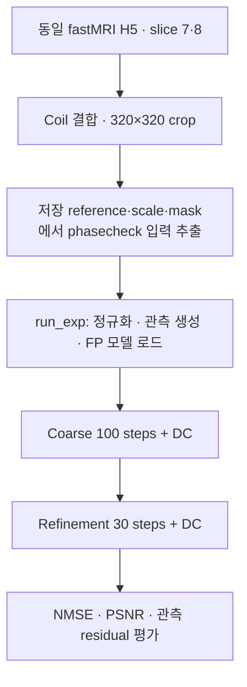

# U-Net-GPTQ 모델 및 실험 구조
[2026.10.19]
[2026.11.23(수정)]

문서에서는 U-Net-GPTQ 모델 구조 및 FP 파일럿 결과를 서술한다.

## 1. 현재 실험의 목적과 진행 상태

파일럿의 연구 질문은 **“무릎 MRI로 학습한 prior를 뇌 FLAIR에 적용했을 때, GPTQ 가중치 양자화는 같은 모델의 복원 품질과 데이터 일관성(data consistency, DC)을 얼마나 바꾸는가?”**이다.

현재 FP/W4 비교 러너와 GPTQ 구성요소를 구현했다. 이번 실험에서는 후속 양자화 비교의 기준을 마련하기 위해 **비양자화 FP 모델에서 DC 가중치 α=0.5와 α=1.0의 복원 결과**를 비교했다. 다음 단계에서는 같은 체크포인트에서 생성한 W4 모델을 FP 모델과 비교한다.

프로젝트의 현재 실행 경로는 **복소 MRI 두 장 → 4채널 U-Net → coarse sampling → 표본 평균 → refinement → FP/W4 비교**다. GPTQ 가중치는 실험 전에 별도로 생성하며, 실험 러너는 저장된 가중치를 불러온다.

## 2. 모델과 복원 방식

DiffuseRecon의 U-Net은 인접한 복소 슬라이스 두 장을 `[Re(z₀), Im(z₀), Re(z₁), Im(z₁)]`의 실수 4채널로 처리한다. Encoder–decoder, residual block, skip connection, timestep embedding과 middle attention으로 구성된다. 이번 설정은 `learn_sigma=False`이므로 모델 출력도 4채널이다.

같은 denoiser 가중치를 두 diffusion schedule에서 재사용한다. Coarse 단계는 Gaussian 초기 상태에서 sampling과 DC를 반복하고, refinement는 coarse 결과를 추가 보정한다. 여러 coarse 표본을 생성하면 평균 후 refinement하지만, 이번 실험은 `num_samples=1`이다. 반환 영상은 complex `[B, 2, H, W]`다.

DC는 binary mask `M`의 관측 위치에 다음 보정을 적용한다.

$$
k_{\mathrm{DC}}=k_{\mathrm{pred}}+\alpha M\odot(y_{\mathrm{target}}-k_{\mathrm{pred}}),
\qquad x_{\mathrm{DC}}=F^{-1}(k_{\mathrm{DC}}).
$$

α=0.5는 예측과 관측을 섞는 soft DC, α=1.0은 관측 위치를 target으로 대체하는 hard DC다. **α와 mask 값은 별개**이며, FFT/DC는 unshifted·`norm="backward"`·complex64를 사용한다. Coarse 중간에는 단계별 noisy target을, 마지막 coarse 단계와 refinement에서는 원래 관측값을 사용한다.

## 3. 데이터 준비와 실험 조건

두 경로 모두 **`file_brain_AXFLAIR_200_6002469.h5`의 slice 7·8**을 사용했다.

공유된  `simple_matrics.py::export_pilot_inputs()`는 원본 파일럿 NPZ의 `reference × scale`과 mask를 이용해 `slice7.pt`, `slice8.pt`, `mask.pkl`, `prepared_inputs.json`을 만든다. `--phase-check`는 영상에 checkerboard 위상을 곱하고 mask를 함께 이동한다. 저장된 mask의 해석은 unshifted다.

(**추출에 coarse·최종 복원 영상을 사용하지 않으므로, 앞선 복원 오차가 다음 입력으로 전달되지는 않는다.** `run_exp.load_case()`는 두 `.pt`를 pickle로 읽어 정규화한 뒤 `observed = mask × FFT(reference)`를 생성한다. H5를 직접 읽는 기능은 별도 전처리 경로에 있다.)

| 항목 | 이번 실행 설정 |
| --- | --- |
| FP checkpoint | `ema_0.9999_150000.pt` |
| 모델 | `num_channels=128`, `num_res_blocks=3`, `dropout=0.3`, `learn_sigma=False` |
| Diffusion | `diffusion_steps=4000`, cosine schedule, coarse 100 steps |
| Refinement / 표본 | 30 steps / 1개 |
| Seed / 정밀도 | sampling seed=0, model_init_seed=0, `use_fp16=True`, `cuda:0` |
| 정규화 | full-reference의 slice별 `max(abs(real), abs(imag))` |
| 추가 검사 | `diagnostics=False`, `check_fp_repeat=False` |

FP는 비양자화를 뜻하며 FP32 전용 실행을 의미하지 않는다. 위 값은 이번 manifest의 설정으로, 코드 기본값과 구분한다.

### 현재 코드의 기본값과 입력 경로

| 설정 | FP 파일럿 (`inspect_utils.py`) | FP/W4 비교 (`run_exp.py`) |
| --- | --- | --- |
| DC α | `run_pilot()` 함수 기본값 `1.0`, 명령행 `--dc-weight` 기본값 `0.5` | 명령행 `--dc_weight` 기본값 `0.5` |
| 모델 정밀도 | 기본 FP16 (`precision="fp16"`, `--precision fp16`) | 기본 FP32, `--use_fp16`으로 FP16 사용 |
| Coarse 단계 | `coarse_steps=100`, `--coarse-steps` 기본값 `100` | `--timestep_respacing` 기본값은 빈 문자열 (`""`); 100단계가 기본값은 아님 |
| 입력 | fastMRI HDF5에서 슬라이스 쌍 추출 | 전처리된 이미지 pickle 두 개 |
| Mask | 파일럿에서 생성 | `--mask_path`로 지정한 저장된 mask 파일을 읽음 |
| Sampling seed | `seed=0`, `--seed` 기본값 `0` | `--seeds` 기본값 `0, 1, 2` |

파일럿 함수 직접 호출과 명령행 실행은 DC 기본값이 다르다. 두 실행 경로를 비교할 때는 DC, 정밀도, coarse 단계 수, 입력·mask, sampling seed를 명시적으로 맞춘다. 위 실험의 coarse 100단계·FP16·seed 0은 실제 실행 설정이며 FP/W4 비교 러너의 기본값을 뜻하지 않는다.

| 입력 폴더 | 원본 파일럿 α | 후속 복원 α | 후속 실행 폴더 |
| --- | --- | --- | --- |
| `6002469_s7_s8_phasecheck1` | 0.5 | 0.5 | `fp_6002469_phasecheck_20261019_122345` |
| `6002469_s7_s8_phasecheck2` | 1.0 | 1.0 | `fp_6002469_phasecheck_20261019_122510` |

평가 관측은 complex coil 결합 영상에서 만든 **synthetic single-coil 관측**이며, reference magnitude를 fastMRI `reconstruction_rss`와 동일하게 취급하지 않는다.

## 4. FP 파일럿 결과

NMSE는 reference와 복원 영상의 **magnitude 상대 제곱오차**, PSNR은 slice별 reference magnitude 최댓값을 peak로 사용한다. DC residual은 원래 관측 k-space에 대한 상대 L2 오차다. 아래 값은 인접 두 slice의 산술평균이며, PSNR도 slice별 dB를 평균했다.

| DC α | 단계 | NMSE ↓ | PSNR (dB) ↑ | DC relative L2 ↓ |
| --- | --- | --- | --- | --- |
| 0.5 | Coarse | 0.083696 | 21.832 | 1.984e-02 |
| 0.5 | Refined | 0.016161 | 28.926 | 8.864e-03 |
| 1.0 | Coarse | 0.090365 | 21.502 | 1.619e-07 |
| 1.0 | Refined | 0.015503 | 29.113 | 1.608e-07 |

- Refinement 후 평균 NMSE는 α=0.5에서 **80.69%**, α=1.0에서 **82.84%** 감소했다.
- α=1.0 실행은 coarse NMSE가 더 높았지만, 최종 NMSE는 α=0.5보다 **4.08% 낮고**, PSNR은 **0.186 dB 높았다**.
- 최종 관측 residual은 α=0.5에서 약 **0.886%**, α=1.0에서 **1.608×10⁻⁷**이었다. Hard DC는 관측 위치에서 residual을 매우 낮게 유지한다. 이는 관측 위치의 일치를 나타내며, 비관측 영역의 정확도를 보장하지는 않는다.

### FP reconstruction 파일별 비교

저장된 NPZ에서 재계산하여 제공된 값. 

| 실행 | α | seed | 정밀도 | ZF NMSE | Coarse NMSE | 최종 NMSE | 최종/ZF | 최종 PSNR (dB) | 최종 DC relative L2 | Sampling 시간 (초) |
| --- | ---: | ---: | --- | ---: | ---: | ---: | ---: | ---: | ---: | ---: |
| alpha0.5 | 0.5 | 0 | FP16 | 0.030594 | 0.083696 | 0.016161 | 0.528252 | 28.926 | 8.864e-03 | 21.8221 |
| alpha1.0 | 1.0 | 0 | FP16 | 0.030594 | 0.090365 | 0.015503 | 0.506721 | 29.113 | 1.666e-07 | 22.0393 |

지표는 slice 7·8의 산술평균이며, 최종/ZF는 평균 NMSE의 비율이다. Sampling 시간은 두 slice를 함께 복원한 실행당 기록값이다.

따라서 이번 사례에서는 refinement의 품질 개선과 hard DC의 관측 일관성을 확인했다. α=1.0 실행의 최종 NMSE와 PSNR이 α=0.5보다 더 좋았다.

## 5. GPTQ 구현과 후속 실험

양자화는 `run_exp.py` 실행 전에 별도로 수행한다.

1. FP checkpoint를 로드하고 calibration 중 denoiser의 레이어 입력을 수집한다.
2. `GPTQ` 또는 `Conv2dGPTQ`가 입력 통계에 기반한 Hessian 근사와 순차 오차 보상으로 선택 가중치를 W4로 양자화한다.
3. `save_gptq_artifact()`로 `weights_w4.pt`, `manifest.json`, `quantization.pt`를 저장하고 러너에 FP/W4를 전달한다.

Conv2d collector는 입력 patch를 사용하며 현재 `groups=1` 등의 제약이 있다. Calibration 데이터·timestep·대상 레이어 선택은 별도로 구성해야 한다. 기본 artifact는 **역양자화한 floating-point 가중치**로 실행되므로 packed INT4의 속도·메모리 이점을 입증하는 결과로 사용할 수 없다.

후속 FP/W4 비교에서는 동일 입력·mask·seed·FFT/DC 정책을 적용하고, 최종 품질과 함께 동일한 noisy state에서의 denoiser 출력 차이 및 DC residual을 기록한다. 해당 진단 기능은 이번 FP 파일럿에서 비활성화되어 있다. Weight-only 비교 이후 activation A4 및 선택적 A8 승격을 검토하되, 이 정책은 향후 구현·검증 대상이다.

## 6. 해석 범위와 다음 확인 사항

- **동일 원본 H5·slice 사용 하였다.**
- 한 볼륨의 인접 두 slice와 seed 하나를 사용한 파일럿이다. CSV 8개 행과 PSNR 산술 관계는 확인했지만, 복원 배열에서 지표를 독립 재계산하지는 않았다.
- 이번 자료에는 같은 입력의 zero-filled 지표, SSIM, 영상 비교, W4 결과 및 시간·GPU 메모리 분석이 없다. 이전 실행은 refinement 20회였으므로 이번 개선을 phase 변환만의 효과로 단정하지 않는다.

### 주요 코드와 근거

경로는 저장소 루트 기준이다.

| 역할 | 파일 |
| --- | --- |
| 실행·모델 로드·평가 | `src/unet_gptq/train/run_exp.py` |
| Coarse / refinement loop | `src/unet_gptq/diffusion/samplers.py` |
| Soft / hard DC 및 residual | `src/unet_gptq/domain/data_consistency.py` |
| H5 로딩·coil 결합·crop | `src/unet_gptq/datas/fastmri_dataset.py` |
| GPTQ 및 Conv2d calibration | `src/unet_gptq/quantization/gptq.py`, `src/unet_gptq/quantization/conv_gptq.py` |
| 동일 입력 denoiser 진단 | `src/unet_gptq/diffusion/diagnostics.py` |

모델은 외부 `improved_diffusion.script_util_duo.create_model_and_two_diffusion()`에서 생성한다. 원문 구조 설명의 소스는 [UNet-GPTQ](https://github.com/HelenJeon0052/UNet-GPTQ/tree/3be045902dbc25c7882057bc6a003c2c7862e5ef)와 [DiffuseRecon](https://github.com/cpeng93/DiffuseRecon/tree/13a9e166185a959e7196b0c9e3d170b8ec50dc0e)이다. 실험 수치는 위 두 실행의 `metrics.csv`와 manifest 발췌문이다.

> 기준: 2026-10-19 · [HelenJeon0052/UNet-GPTQ](https://github.com/HelenJeon0052/UNet-GPTQ) · 커밋 `3be045902dbc25c7882057bc6a003c2c7862e5ef`  
> 외부 모델: [cpeng93/DiffuseRecon](https://github.com/cpeng93/DiffuseRecon) · 커밋 `13a9e166185a959e7196b0c9e3d170b8ec50dc0e`  
> 작성 범위: 해당 커밋의 소스 코드.
